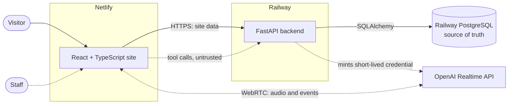

# Architecture

One frontend, one backend, one database. Solid lines exist today; dashed lines are planned and are not yet built.

## Where authority lives

| Concern | Owner | Why |
|---|---|---|
| Permanent OpenAI key | Backend only | Never sent to the browser |
| Session instructions and tool list | Backend, set when minting the credential | The browser cannot rewrite them through this API path |
| Business identity | Backend configuration | Never accepted from a request |
| Availability and booking success | PostgreSQL through backend rules | The model can only report results it receives |
| Tool arguments | Untrusted input, validated on every call | They pass through the browser and originate from a model hearing user speech |
| Staff access | Hashed bearer sessions, scoped to the staff member's business | See [decision 0004](decisions/0004-staff-authentication.md) |

## Health checks

| Endpoint | Meaning | Use |
|---|---|---|
| `GET /health` | The process is up. No database call | Container liveness |
| `GET /health/ready` | Database reachable and schema at the revision this build expects | Deploy verification |

Records of the reasoning: [voice](decisions/0001-voice-architecture.md), [booking consistency](decisions/0002-booking-consistency.md), [scope](decisions/0003-scope.md).

## Availability

`app/availability.py` separates a pure calculation from the database queries that feed it, so time zone and overlap rules can be tested exactly. Bookings are stored in UTC with the appointment end and the end of the trailing buffer, and the business time zone is applied per date.
